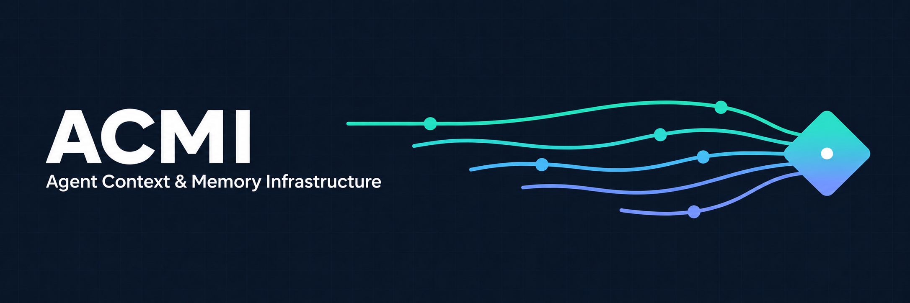
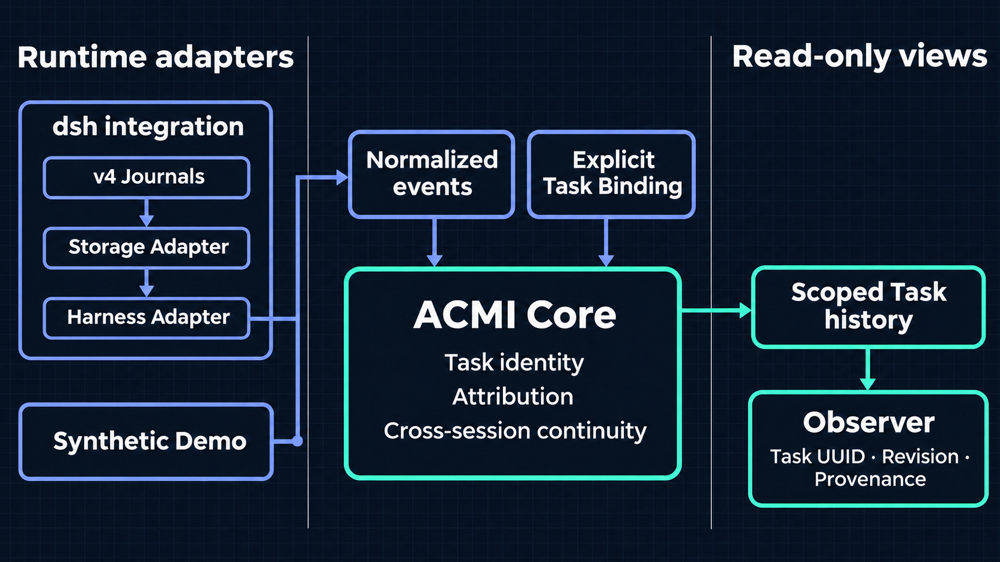

# ACMI



[简体中文](README.zh-CN.md)

ACMI (Agent Context & Memory Infrastructure) gives agent runtimes a way to
identify work across sessions. A Task keeps the same UUID as a session switches
tasks or a later session resumes it. ACMI records explicit bindings and serves
read-only history with provenance. It is not an agent harness, an automatic
task recognizer, or a long-term memory engine.

**Alpha:** run the deterministic Synthetic Demo without a running dsh host,
credentials, or a model. `main` also carries the research history through
Phase 0.9.16; it does not enable automatic task routing.
The first official integration is [DeepSeek Harness (dsh)](integrations/dsh/README.md),
targeting `0.2.2-rc.1`; see the [dsh Quick Start](examples/dsh-quickstart/README.md)
for setup and compatibility. To connect another runtime, start with the
[Adapter Authoring Guide](docs/adapter-authoring.md) and the
[custom adapter example](examples/custom-agent-adapter/README.md).

## Quick start

For the experimental, provider-free persistent task console, see the
[explicit continuation example](examples/task-console/README.md). It requires
dedicated roots and operator confirmation; it is not a chat client or model
context recovery. See the [current checkpoint](docs/runbooks/phase-0.9.17-progress-checkpoint.md)
for validation limits and [workspace organization](docs/workspace-organization.md)
for the main/feature directory split.

```sh
pnpm install --frozen-lockfile
pnpm build
pnpm demo
```

The demo shows Task switching and resumption, a causal Tool Call/Result pair,
an unresolved event, and read-only cross-session history. Use the
[Getting Started guide](docs/getting-started.md) to open the Observer timeline.

## Architecture



The diagram shows data flow, not package dependencies. Core is independent of
dsh and keeps ambiguous events unresolved rather than guessing their Task.
See the [architecture guide](docs/architecture.md) for the component boundaries.

## Experiment record

See the [chronological experiment log](docs/experiments/README.md) for the
questions, results, failures, preregistrations, and replayable synthetic evidence.
ACMI first tested explicit task continuity and deterministic recovery, then
offline identity advice, and finally whether one local model generation could
emit both the user answer and a private attribution proposal.

- [0.9.10](docs/experiments/phase-0.9.10-final-report.md): all 24 completions emitted
  both fields, but strict validation delivered **0/24** native answers. The
  pilot stopped before the main paired and post-hoc comparisons.
- [0.9.11](docs/experiments/phase-0.9.11-assignment-pilot-report.md) separated
  answer validation from attribution. Native answers and tool causality worked
  in the isolated test; semantic qualification still failed.
- [0.9.14](docs/experiments/phase-0.9.14-work-anchor-report.md): a verified
  WorkAnchor improved explicit continuation from **0/4 to 4/4**, not general
  identity resolution. [0.9.15](docs/experiments/phase-0.9.15-relative-proposals-report.md)
  improved new-goal proposals but still missed the model gate.
- [0.9.16](docs/experiments/phase-0.9.16-unresolved-link-report.md): the model
  never used the new unresolved-subject reference. Assistant accuracy stayed
  **7/12** and User accuracy fell from **11/12 to 9/12**. This is a NO-GO for the
  tested contract, not a claim about all models.

Same-generation output is feasible in the tested buffered path; reliable open
task attribution and production streaming are not qualified. The model proposes;
the trusted Host validates. An anchor does not authorize tools. A late tool
result inherits its original call, not the current task. Nothing here enables
automatic Binding, graph writes, result acceptance, or joins.

## What the Alpha tests verify

Release baseline: [v0.1.0-alpha.1](https://github.com/Violet-2ai077/ACMI/releases/tag/v0.1.0-alpha.1)
(`0531dbf`).

| Check | Verified result |
| --- | --- |
| [GitHub Actions run](https://github.com/Violet-2ai077/ACMI/actions/runs/42630365718) | Windows and Ubuntu jobs passed, including frozen dependency installation, dependency audit, and `pnpm check`. |
| Independent clean clones | **28/28 tests passed on each** of Windows x64 and Ubuntu 24.04 (WSL), across 9 test files. Both runs built the workspace and ran the Synthetic Demo, custom adapter, and dsh Quick Start. |
| [dsh integration tests](integrations/dsh/tests/dsh.test.ts) | With dsh `0.2.2-rc.1`, the dedicated v4 journal fixture passed [Level 4 conformance](packages/conformance/README.md): an independently reopened adapter recovered Task history across two Sessions. Reads left both plaintext and Zstandard journal files byte-for-byte unchanged in their respective fixtures. |
| [Observer HTTP test](examples/dsh-quickstart/tests/observer-http.test.mjs) | The local synthetic Observer served its read-only timeline and rejected write requests. |

To reproduce the build, tests, and demos, install the pinned versions from
[`package.json`](package.json), run `pnpm install --frozen-lockfile`, then run
`pnpm check`. These are controlled fixture and integration checks; they do not
validate live model traffic or establish production security guarantees.

**Safety:** automatic persistent Binding is disabled; heuristic and model-based
attribution experiments do not authorize runtime actions. dsh history requires
a trusted local host and an isolated Storage Root for one Workspace. Windows hostile filesystem races,
multi-tenant service, and the Claude Code and Codex adapters are not supported.
See [Security](SECURITY.md) and [Security Limitations](docs/security-limitations.md).

## Workspace

| Area | Responsibility |
| --- | --- |
| [`@acmi/contracts`](packages/contracts/README.md) | Task, Session, Binding, provenance, and adapter contracts |
| [`@acmi/core`](packages/core/README.md) | Runtime-neutral Task identity, explicit Binding, attribution, and read-only history |
| [`@acmi/sdk`](packages/sdk/README.md) | Adapter-facing validation and capability negotiation |
| [`@acmi/conformance`](packages/conformance/README.md) | Fixture-based adapter conformance checks |
| [dsh integration](integrations/dsh/README.md) | dsh Plugin, Harness Adapter, and Storage Adapter |
| [Observer](apps/observer/README.md) | Read-only companion view, not a native dsh-context tab |

See [Roadmap](ROADMAP.md), [Alpha release notes](docs/releases/v0.1.0-alpha.1.md),
[Contributing](CONTRIBUTING.md), and [Support](SUPPORT.md).

ACMI-original material is [MIT licensed](LICENSE). See
[Third-party Notices](THIRD_PARTY_NOTICES.md) and
[Source Provenance](docs/source-provenance.md) for exceptions and upstream reuse.
