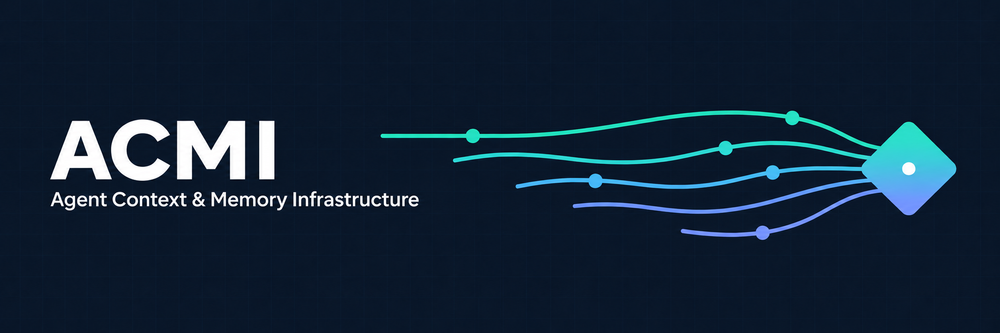
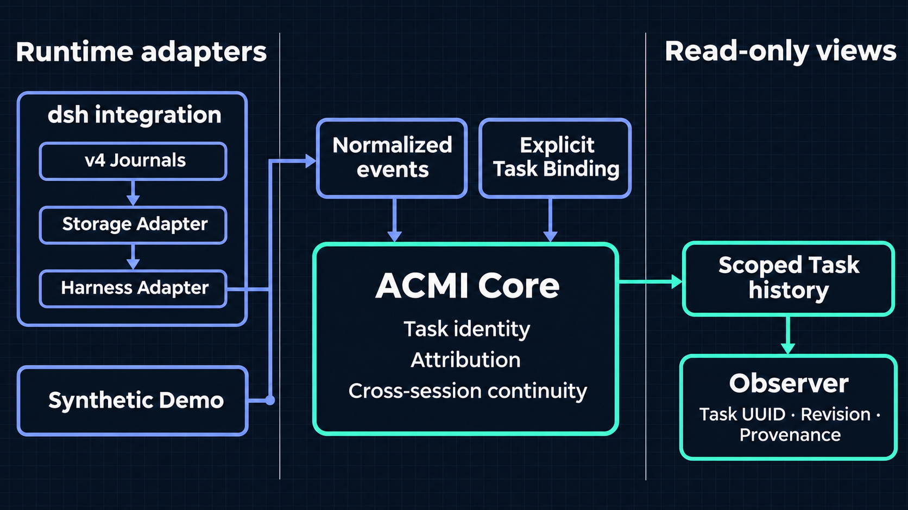

# ACMI



[简体中文](README.zh-CN.md)

ACMI (Agent Context & Memory Infrastructure) gives agent runtimes a way to
identify work across sessions. A Task keeps the same UUID as a session switches
tasks or a later session resumes it. ACMI records explicit bindings and serves
read-only history with provenance. It is not an agent harness, an automatic
task recognizer, or a long-term memory engine.

**Alpha & Sealed Path 1 Research Asset:** run the deterministic Synthetic Demo
without a running dsh host, credentials, or a model. `main` also carries the
complete, sealed **Path 1 Mechanism Validation** record through Phase 0.9.19 and
the **484-call single-factor ablation suite**
([synthesis report](docs/research/path1-mechanism-validation-synthesis-20261121.md));
it does not enable automatic task routing in the core runtime. The latest
[model-native attribution checkpoint](research/phase-0.9.19/STATUS.md) and the
self-contained ablation suites under [`experiments/th1-b`](experiments/th1-b/REPORT.md),
[`experiments/tc5-b`](experiments/tc5-b/REPORT.md),
[`experiments/tc3-b`](experiments/tc3-b/REPORT.md), and
[`experiments/st1-staging`](experiments/st1-staging/REPORT.md) separate falsified
heavy state-maintenance schemas from **five validated closed-loop primitives**.
This repository is preserved as an independent research and benchmark asset;
subsequent Path 2 lightweight practical tooling built on these five primitives
proceeds decoupled.
The first official integration is [DeepSeek Harness (dsh)](integrations/dsh/README.md),
targeting `0.2.2-rc.1`; see the [dsh Quick Start](examples/dsh-quickstart/README.md)
for setup and compatibility. To connect another runtime, start with the
[Adapter Authoring Guide](docs/adapter-authoring.md) and the
[custom adapter example](examples/custom-agent-adapter/README.md).

## Quick start

For the experimental, provider-free persistent task console, see the
[explicit continuation example](examples/task-console/README.md). It requires
dedicated roots and operator confirmation; it is not a chat client or model
context recovery. See the [current checkpoint](docs/runbooks/phase-0.9.17-progress-checkpoint.md)
for validation limits and [workspace organization](docs/workspace-organization.md)
for the main/feature directory split.

For explicitly confirmed, text-only local model requests using isolated test
data, use the separate [model continuation console](examples/task-console/MODEL-README.md).
It prepares bounded task evidence for each fresh Session, not automatic routing
or general memory recovery. See the [verification report](docs/verification/2026-11-14-model-continuation.md)
for deterministic and real-model evidence separately.

```sh
pnpm install --frozen-lockfile
pnpm build
pnpm demo
```

The demo shows Task switching and resumption, a causal Tool Call/Result pair,
an unresolved event, and read-only cross-session history. Use the
[Getting Started guide](docs/getting-started.md) to open the Observer timeline.

## Architecture



The diagram shows data flow, not package dependencies. Core is independent of
dsh and keeps ambiguous events unresolved rather than guessing their Task.
See the [architecture guide](docs/architecture.md) for the component boundaries.

## Path 1 Research Findings: Mechanism Validation (Nov 2026)

Full report: **[Path 1 Mechanism Validation Synthesis](docs/research/path1-mechanism-validation-synthesis-20261121.md)** | Raw Phase 0.9.19 evidence archive: **[`archive/phase-0.9.19-raw-evidence`](https://github.com/Violet-2ai077/ACMI/tree/archive/phase-0.9.19-raw-evidence)** (`origin/research/th1-handoff-20261120`)

### 1. What question we set out to answer

In real developer workflows, **Session ≠ Task**: a single conversation interleaves multiple distinct work objectives, and a single task spans multiple sessions, context compactions, and handoffs. Path 1 decomposed "agent memory" into three strictly separate mechanism layers — **Task Identity** (which task does this turn belong to?), **State Maintenance** (how are workspace decisions, falsifications, and open questions updated without corrupting user answers?), and **Cross-Session Continuity** (how does compacted task context combine with workspace state during handoff?) — to test what a model (`deepseek-v4.1-flash`) can and cannot do reliably.

### 2. Core experiments executed

Following the historical exploratory phases (`Phase 0.9.10–0.9.16`, `FM1` [48 calls], `BS1` [32 calls], `TC1–TC5` [110 calls], and `TH1` [24 calls]), we executed **484 pre-frozen, zero-retry, deterministic single-factor ablation calls** across four self-contained suites:

- **[`experiments/th1-b/`](experiments/th1-b/REPORT.md) (TH1-B Stale-Rule Resurrection Ablation, 264 calls = 88 tasks × `{max, low, none}`)**: 8 counterbalanced isomorphic scenarios (`V0–V7`, including original TH1, sandwich order reversal, two-hop global override, and competing local-seal negative controls) testing `filtered` vs `compact` representations, stale-footer pollution `P0` vs purged `P1`, baseline receiver `C0` vs authoritative-override contract `C1`, and hard-boundary task compression `COMPRESSOR_STRICT`.
- **[`experiments/tc5-b/`](experiments/tc5-b/REPORT.md) (TC5-B Implicit Ambiguity Recency/Primacy Counterbalance & Anti-Default Attribution, 88 calls at `max`)**: 32 counterbalanced prefix probes × `{C0, C1}` across 4 domains decoupling Recency from Primacy (Experiment A, 64 calls) + a full 24-turn closed-loop regression on the original `TC5` stories (`warehouse-queries` and `pottery-notices`) under `SYSTEM_C1` (Experiment B, 24 calls).
- **[`experiments/tc3-b/`](experiments/tc3-b/REPORT.md) (TC3-B De-Greenhouse 24-Turn Continuity Stress Test, 72 calls at `max`)**: 3 progressive history-stripping conditions (`S0_baseline`, `S1_strip_cot`, `S2_strip_cot_and_header`) × 24 turns on the 5-task `overlapping-notices` story (up to 14 intervening turns at Turn 24).
- **[`experiments/st1-staging/`](experiments/st1-staging/REPORT.md) (ST1 Asynchronous Staging State Operator Extraction, Host Deterministic Folding & Cross-Worker Tombstone Anti-Regression, 60 calls at `max`)**: 6 multi-hop engineering evolution scenarios × 4 steps with zero internal handle leaks in dialogue (Part A1, 24 calls) + 12 authority/scope/resurrection boundary traps (Part A2, 12 calls) + 4-Arm cross-worker handoff & tombstone ablation (Part B, 24 calls).

### 3. Empirical results: what was falsified vs what was validated

| Mechanism Question | Study & Call Count | Empirical Result | Verdict & Mechanism Takeaway |
| --- | --- | --- | --- |
| **Same-generation heavy structured state JSON** (answer + nested UUID/decision/status tree) | `Phase 0.9.10` (24 calls)<br>`FM1` (`finite-v1`, 48 calls) | `0.9.10`: **0/24** valid native answers.<br>`FM1`: **4/6 decision reversals** (prose chose green `#1F7A5C`, state JSON wrote blue `#2B4C7E`), **UUID mutation (`102 -> 103`)**, ghost item retention. | **FALSIFIED & RETIRED.** Never ask the model to maintain or re-emit a structured work-state JSON tree alongside its answer. |
| **Naive compaction & uncontracted handoff** (task summary + workspace `memory`) | `TH1` (24 calls)<br>[`TH1-B`](experiments/th1-b/REPORT.md) `P0_C0` (48 calls across 3 tiers) | `compact_P0_C0`: **0/8 (0%) pass, 100% (8/8) stale-footer resurrection** across `max`, `low`, and `none`.<br>`filtered_P0_C0`: **4/8 (50%)** at `max` (3/8 trapped in 4,096-token CoT loop), **3/8 (37.5%)** at `none`. | **FALSIFIED.** Compaction strips turn numbers and flattens old rules into timeless assertions, causing 100% stale-rule resurrection without an authority contract. |
| **Hard Global/Local Boundary Compressor + Authoritative Handoff Contract** | [`TH1-B`](experiments/th1-b/REPORT.md) `C1` & `COMPRESSOR_STRICT` (264 calls total) | `RECEIVER_C1`: **120/120 (100%) pass, 0% stale resurrection, 0% local corruption** across `max`, `low`, `none`.<br>`COMPRESSOR_STRICT`: **24/24 (100%) pass, 0% global-rule leak**.<br>`max` `P0_C0 -> P0_C1`: reasoning tokens **1708.6 -> 162.9 (-90.5%)**, latency **18.12s -> 4.56s (4.0x faster)**. | **VALIDATED.** Upstream global/local isolation (`COMPRESSOR_STRICT`) and downstream authority override (`RECEIVER_C1`) form a closed loop across all reasoning tiers. |
| **Implicit ambiguity root cause & Anti-Default Attribution Contract** | `TC5` (24 calls)<br>[`TC5-B`](experiments/tc5-b/REPORT.md) (88 calls) | Exp A `C0`: **4/4 default guesses hit `recent_relevant` (`0/16` older)** — proving **100% Recency bias** (not Primacy).<br>Exp A `SYSTEM_C1`: **16/16 (100%) ambiguity clarify, 0/16 (0%) over-abstention, 16/16 (100%) unambiguous returns**.<br>Exp B `SYSTEM_C1`: **4/4 (100%)** implicit ambiguity turns clarified (vs 1/4 in `TC5`), eliminating `t7` cross-task contamination; **24/24** semantic marker identity exact. | **VALIDATED.** A single-factor anti-Recency contract (`SYSTEM_C1`) eliminates default guessing on underdetermined requests with zero over-abstention penalty. |
| **De-greenhouse 24-turn inline tail-marker continuity** (stripping historical CoT and client headers) | `TC1–TC4` (86 calls)<br>[`TC3-B`](experiments/tc3-b/REPORT.md) (72 calls) | `S0_baseline`: **24/24 (100%)**.<br>`S1_strip_cot`: **24/24 (100%)**.<br>`S2_strip_cot_and_header`: **24/24 (100%)** (including Turn 24 at `gap=14` without historical CoT or `【...】`/client proper nouns).<br>Long-return (`gap=5..14`) mean CoT tokens rose **151.7 (`S0`) -> 295.3 (`S1`, +94.7%) -> 346.7 (`S2`, +128.5%)**. | **VALIDATED.** Inline `<\|task:N\|>` markers are self-sufficient in plain de-greenhouse history; stripping CoT/headers incurs an online CoT re-scan tax on long gaps that a host-compiled read-only 1-line task catalog can amortize. |
| **Async Staging Operator Extraction + Host Deterministic `foldLedger` + Tombstone Anti-Regression** | [`ST1`](experiments/st1-staging/REPORT.md) (60 calls) | Part A1 (24 multi-hop steps, zero handle leaks): **24/24 (100%)** exact ops & `target_id`, **0/24** false writes, **0** Host rejections (`162.0` CoT tokens / `2.81s`).<br>Part A2 (12 boundary traps): **12/12 (100%)**, **0/12** false writes (`36.8` CoT tokens / `1.80s`).<br>Part B (24 handoffs): `ledger_staged_C1` & `ledger_gold_C1` **6/6 (100%)** at **105.0 CoT tokens / 2.16s** (**-58.4%** CoT tokens vs `raw_noisy_C0` `252.7` tokens); stripping `tombstones` (`ledger_staged_no_tombstone_C1`) dropped evidence citation to **0/6 (0%)**. | **VALIDATED.** Out-of-band operator staging + deterministic Host folding (`Active HEAD` + `Tombstones` + `Open Questions`) completely replaces same-generation state JSON and proves `tombstones` are causally required for anti-regression provenance. |

### 4. Five closed-loop architectural primitives for Path 2 (Decoupled Practical MVP)

With Path 1 sealed in this repository as a research and benchmark asset, Path 2 (Lightweight Practical MVP Tooling, developed decoupled from this repo) is specified by **five validated closed-loop primitives**:

1. **Inline Identity Tail Marker (`<|task:N|>` / `<|task:UNRESOLVED|>`) + Anti-Recency Contract (`SYSTEM_C1`) + Host Light Task Catalog**: Keep primary generation overhead to a single trailing marker token (with closed-fence-aware parsing so ```` ```...```\n<|task:N|> ```` is accepted), backed by a host-compiled read-only 1-line-per-task catalog and verified `WorkAnchor` for explicit operator selection.
2. **Independent Asynchronous Staging Restricted State Operator Extraction (`STAGING_EXTRACTOR_PROMPT`)**: Extract workspace state changes out-of-band via four restricted delta operators (`ASSERT`, `SUPERSEDE`, `OPEN_QUESTION`, `RESOLVE_QUESTION`, plus `NO_OP`), enforcing authority, equal-conflict, and global/local scope gates without touching the user-facing response generation.
3. **Host Deterministic `foldLedger` Workspace State Ledger (`Active HEAD` + `Tombstones` + `Open Questions`)**: A pure-function Host reducer exclusively allocates short handles (`D1, D2...`, `Q1, Q2...`), rejects invalid transitions, and preserves explicit `tombstones` (superseded options + objective falsification `reason`) alongside `active` decisions and `open_questions`.
4. **Hard Global/Local Boundary Compressor (`COMPRESSOR_STRICT`)**: Strip workspace-global rules from task-local compaction summaries at the schema boundary so task notes carry only local artifact trails and local state.
5. **Authoritative Override Handoff Contract (`RECEIVER_C1`)**: Pair every compacted or cross-worker handoff with the explicit rule that `workspace_ledger.active` is the sole authority for active global state, `workspace_ledger.tombstones` forbids unratified rollbacks with objective falsification evidence, and resolved `open_questions` are closed.

## Chronological experiment record

See the [chronological experiment log](docs/experiments/README.md) for the
questions, results, failures, preregistrations, and replayable synthetic evidence
from Phases 0.6 through 0.9.19 and Path 1 closure:

- [0.9.10](docs/experiments/phase-0.9.10-final-report.md): all 24 completions emitted
  both fields, but strict validation delivered **0/24** native answers. The
  pilot stopped before the main paired and post-hoc comparisons.
- [0.9.11](docs/experiments/phase-0.9.11-assignment-pilot-report.md) separated
  answer validation from attribution. Native answers and tool causality worked
  in the isolated test; semantic qualification still failed.
- [0.9.14](docs/experiments/phase-0.9.14-work-anchor-report.md): a verified
  WorkAnchor improved explicit continuation from **0/4 to 4/4**, not general
  identity resolution. [0.9.15](docs/experiments/phase-0.9.15-relative-proposals-report.md)
  improved new-goal proposals but still missed the model gate.
- [0.9.16](docs/experiments/phase-0.9.16-unresolved-link-report.md): the model
  never used the new unresolved-subject reference. Assistant accuracy stayed
  **7/12** and User accuracy fell from **11/12 to 9/12**. This is a NO-GO for the
  tested contract, not a claim about all models.
- [Path 1 Single-Factor Ablations (`TH1-B`, `TC5-B`, `TC3-B`, `ST1`)](docs/research/path1-mechanism-validation-synthesis-20261121.md):
  484 controlled calls on `deepseek-v4.1-flash` closing stale-rule resurrection
  (**120/120** under `RECEIVER_C1`, **24/24** under `COMPRESSOR_STRICT`),
  implicit-ambiguity Recency bias (**16/16** clarify and **0/16** over-abstention
  under `SYSTEM_C1`), de-greenhouse 24-turn continuity (**72/72** across
  `S0`/`S1`/`S2`), and asynchronous state operator staging + Host folding +
  tombstone anti-regression (**36/36** staging & traps, **12/12** `C1` ledger
  handoffs, **0/6** evidence citation when tombstones are stripped).

Same-generation lightweight tail-marker output and out-of-band state operator
staging are validated in controlled evaluations; reliable open production
streaming and autonomous runtime binding remain governed by host validation.
The model proposes; the trusted Host validates. An anchor does not authorize
tools. A late tool result inherits its original call, not the current task.
Nothing here enables automatic Binding, graph writes, result acceptance, or joins.

## What the Alpha tests verify

Release baseline: [v0.1.0-alpha.1](https://github.com/Violet-2ai077/ACMI/releases/tag/v0.1.0-alpha.1)
(`0531dbf`).

| Check | Verified result |
| --- | --- |
| [GitHub Actions run](https://github.com/Violet-2ai077/ACMI/actions/runs/42630365718) | Windows and Ubuntu jobs passed, including frozen dependency installation, dependency audit, and `pnpm check`. |
| Independent clean clones | **28/28 tests passed on each** of Windows x64 and Ubuntu 24.04 (WSL), across 9 test files. Both runs built the workspace and ran the Synthetic Demo, custom adapter, and dsh Quick Start. |
| [dsh integration tests](integrations/dsh/tests/dsh.test.ts) | With dsh `0.2.2-rc.1`, the dedicated v4 journal fixture passed [Level 4 conformance](packages/conformance/README.md): an independently reopened adapter recovered Task history across two Sessions. Reads left both plaintext and Zstandard journal files byte-for-byte unchanged in their respective fixtures. |
| [Observer HTTP test](examples/dsh-quickstart/tests/observer-http.test.mjs) | The local synthetic Observer served its read-only timeline and rejected write requests. |

To reproduce the build, tests, and demos, install the pinned versions from
[`package.json`](package.json), run `pnpm install --frozen-lockfile`, then run
`pnpm check`. These are controlled fixture and integration checks; they do not
validate live model traffic or establish production security guarantees.

**Safety:** automatic persistent Binding is disabled; heuristic and model-based
attribution experiments do not authorize runtime actions. dsh history requires
a trusted local host and an isolated Storage Root for one Workspace. Windows hostile filesystem races,
multi-tenant service, and the Claude Code and Codex adapters are not supported.
See [Security](SECURITY.md) and [Security Limitations](docs/security-limitations.md).

## Workspace

| Area | Responsibility |
| --- | --- |
| [`@acmi/contracts`](packages/contracts/README.md) | Task, Session, Binding, provenance, and adapter contracts |
| [`@acmi/core`](packages/core/README.md) | Runtime-neutral Task identity, explicit Binding, attribution, and read-only history |
| [`@acmi/sdk`](packages/sdk/README.md) | Adapter-facing validation and capability negotiation |
| [`@acmi/conformance`](packages/conformance/README.md) | Fixture-based adapter conformance checks |
| [dsh integration](integrations/dsh/README.md) | dsh Plugin, Harness Adapter, and Storage Adapter |
| [Observer](apps/observer/README.md) | Read-only companion view, not a native dsh-context tab |
| [`experiments/`](docs/research/path1-mechanism-validation-synthesis-20261121.md) | Self-contained Path 1 single-factor ablation suites ([`th1-b`](experiments/th1-b/REPORT.md), [`tc5-b`](experiments/tc5-b/REPORT.md), [`tc3-b`](experiments/tc3-b/REPORT.md), [`st1-staging`](experiments/st1-staging/REPORT.md)) |

See [Roadmap](ROADMAP.md), [Alpha release notes](docs/releases/v0.1.0-alpha.1.md),
[Contributing](CONTRIBUTING.md), and [Support](SUPPORT.md).

ACMI-original material is [MIT licensed](LICENSE). See
[Third-party Notices](THIRD_PARTY_NOTICES.md) and
[Source Provenance](docs/source-provenance.md) for exceptions and upstream reuse.
