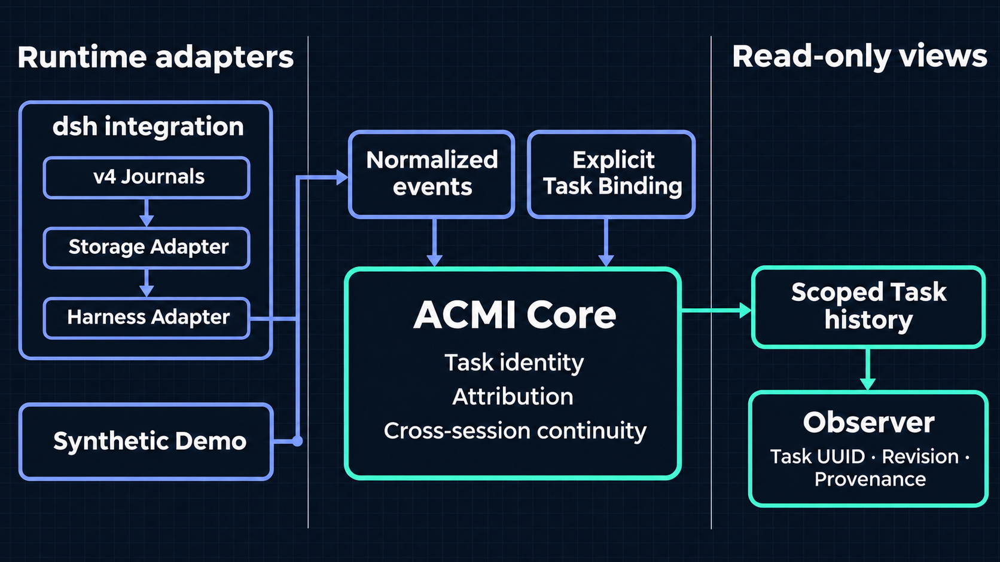

# ACMI


[English](README.md)

ACMI（Agent Context & Memory Infrastructure）为智能体运行时提供跨会话的工作身份。会话切换任务，或另一个会话继续同一任务时，任务 UUID 保持不变。ACMI 记录显式绑定并提供带来源信息的只读历史。它不负责运行智能体，也不是自动任务识别器或长期记忆引擎。

**Alpha 阶段：**无需启动 dsh、提供凭据或调用模型即可运行确定性合成演示。`main` 同时完整收录了截至 Phase 0.9.19 的研究历史与 **第一条研究路线（机制验证）的 424 次单因素消融实验**（详见[第一条路线机制验证终结汇总报告](docs/research/path1-mechanism-validation-synthesis-20261121.md)），不默认启用自动任务路由。最新[模型原生任务归属进度](research/phase-0.9.19/STATUS.md)与独立消融实验目录 [`experiments/th1-b`](experiments/th1-b/REPORT.md)、[`experiments/tc5-b`](experiments/tc5-b/REPORT.md)、[`experiments/tc3-b`](experiments/tc3-b/REPORT.md) 将已被证伪的重型同次状态维护路线与已正面闭合的四条轻量机制原语严格区分。首个官方集成为 [DeepSeek Harness（dsh）](integrations/dsh/README.md)，目标版本为 `0.2.2-rc.1`；安装和兼容性见 [dsh 快速入门](examples/dsh-quickstart/README.md)。接入其他运行时可从[适配器编写指南](docs/adapter-authoring.md)和[自定义适配器示例](examples/custom-agent-adapter/README.md)开始。

## 快速开始

需要持久化的显式任务续接，可查看实验性的[任务控制台](examples/task-console/README.md)。
它使用专用存储根和操作者确认，不调用 Provider，也不是聊天客户端或模型上下文恢复。
验收边界见[当前进度](docs/runbooks/phase-0.9.17-progress-checkpoint.md)，
主线与开发目录的分工见[工作区组织](docs/workspace-organization.md)。

需要验证真实本地模型的显式续接，可使用独立的[模型控制台](examples/task-console/MODEL-README.md)。
该入口只面向隔离测试数据，每轮使用新 Session、显式绑定和独立请求确认，向本地模型提供有界任务历史。
它不启用自动任务识别，也不构成通用记忆恢复；确定性验证与真实模型结果分别记录在[验收报告](docs/verification/2026-11-14-model-continuation.md)。

```sh
pnpm install --frozen-lockfile
pnpm build
pnpm demo
```

演示包含任务切换与恢复、具有因果关联的工具调用和结果、一个未归属事件，以及只读跨会话历史。[入门指南](docs/getting-started.md)说明如何打开 Observer 时间线。

## 架构



图中展示的是数据流，不是包依赖。Core 不依赖 dsh；遇到证据不足的事件时，它会保留未归属状态，而不是猜测所属任务。组件边界详见[架构指南](docs/architecture.md)。

## 第一阶段机制验证结论（2026-11）

完整汇总报告：**[第一条研究路线（机制验证）终结汇总报告](docs/research/path1-mechanism-validation-synthesis-20261121.md)** | Phase 0.9.19 原始重型取证归档：**[`archive/phase-0.9.19-raw-evidence`](https://github.com/Violet-2ai077/ACMI/tree/archive/phase-0.9.19-raw-evidence)**（`origin/research/th1-handoff-20261120`）

### 1. 我们试图回答什么问题

在真实的开发者与智能体协作流中，**会话不等于任务（Session ≠ Task）**：同一个会话往往交错推进多个独立任务，而同一个任务又会跨越多次会话切换、上下文压缩（Compaction）与跨会话交接（Handoff）。第一条研究路线（机制验证）将“智能体上下文与记忆”拆解为三个正交的机制层——**任务身份识别（Identity）**、**工作状态维护（State）** 与 **跨会话压缩交接连续性（Continuity）**，旨在通过严格受控的实证实验回答：大模型（`deepseek-v4.1-flash`）在正常生成用户回答的同时，究竟能可靠承担哪一层职责、不能承担哪一层职责？

### 2. 我们做了哪些核心实验

在前期探索阶段（`Phase 0.9.10–0.9.16`、`FM1` 48 次闭环调用、`BS1` 32 次边界调用、`TC1–TC5` 110 次尾标记调用、`TH1` 24 次压缩交接调用）暴露核心瓶颈的基础上，我们构建并执行了 **424 次预冻结（SHA-256）、零语义/格式重试、零修复器、确定性代码硬判分的单因素消融实验**：

- **[`experiments/th1-b/`](experiments/th1-b/REPORT.md)（TH1-B“旧规则复活”单因素消融，264 次调用 = 88 任务 × `{max, low, none}` 三档推理）**：在 8 个反平衡同构场景（`V0–V7`，覆盖原版 TH1、夹心时间倒置、两跳全局覆盖 `old1 -> old2 -> final` 及竞争局部印章负向控制）上，对输入表示（`filtered` vs `compact`）、旧规则污染（`P0` vs `P1`）、接手方权威契约（`C0` vs `C1`）及全局/局部硬隔离压缩器（`COMPRESSOR_STRICT`）进行全因子消融。
- **[`experiments/tc5-b/`](experiments/tc5-b/REPORT.md)（TC5-B 隐式歧义 Recency/Primacy 反平衡 + 反默认归属契约消融，88 次调用，`max` 档）**：通过 4 个领域、32 个反平衡冻结前缀探针 × `{C0, C1}` 解耦“最近活跃偏置（Recency）”与“首任务编号偏置（Primacy）”（实验 A，64 次调用），并在原版 TC5 的两条 12 轮多任务闭环故事（`warehouse-queries`、`pottery-notices`）上验证 `SYSTEM_C1` 的端到端回归表现（实验 B，24 次调用）。
- **[`experiments/tc3-b/`](experiments/tc3-b/REPORT.md)（TC3-B 去温室 24 轮轻量尾标记压力测试，72 次调用，`max` 档）**：在原版 TC3 24 轮 5 任务交错故事（`overlapping-notices`，19 次无客户名回归、最长间隔 14 轮）上，递进对比 `S0_baseline`（保留历史 `reasoning_content` 与显式抬头）、`S1_strip_cot`（完全剥离历史思维链）与 `S2_strip_cot_and_header`（剥离历史思维链 + 剥除全部 `【...】` 抬头并中性化全部 6 个客户专有名词）。

### 3. 关键实测结果汇总表（证伪了什么 vs 证明了什么）

| 核心机制命题 | 实验批次与调用规模 | 实测关键数据 | 最终裁定与机制结论 |
| --- | --- | --- | --- |
| **同次生成重型结构化状态维护**（回答正文 + 维护嵌套 UUID/决策/验收 JSON 状态树） | `Phase 0.9.10`（24 calls）<br>`FM1`（`finite-v1`，48 calls） | `0.9.10`：整包严格校验下仅 **0/24** 可用原生回答。<br>`FM1`：**4/6 出现决策反转**（正文明确选绿色 `#1F7A5C`，同次生成的 JSON 状态却写成蓝色 `#2B4C7E`）、**既有任务 UUID 篡改（`102 -> 103`）**、幽灵工作项残留。 | **已证伪并永久弃用**。绝不能让模型在回答用户的同一次生成中维护或重发嵌套 JSON 工作状态树。 |
| **无隔离摘要压缩与无权威契约交接**（直接拼接任务摘要与工作区 `memory`） | `TH1`（24 calls）<br>[`TH1-B`](experiments/th1-b/REPORT.md) `P0_C0`（48 calls，跨三档） | `compact_P0_C0`：在 `max` / `low` / `none` 三档下通过率均为 **0/8（0%），100%（8/8）复活旧页脚**。<br>`filtered_P0_C0`：`max` 档仅 **4/8（50%）**（含 3 例陷入 4,096 token 推理死循环耗尽），`none` 档仅 **3/8（37.5%，62.5% 复活）**。 | **已证伪**。常规摘要压缩会抹去轮次时间戳并将已废止规则压平为无时态断言，无权威契约时导致 100% 旧规则复活。 |
| **全局/局部硬隔离压缩（`COMPRESSOR_STRICT`）+ 权威覆盖交接契约（`RECEIVER_C1`）** | [`TH1-B`](experiments/th1-b/REPORT.md) 全矩阵（264 calls） | `RECEIVER_C1`：横跨 `max` / `low` / `none` 三档达成 **120/120（100%）通过、0% 旧规则复活、0% 局部状态损坏**。<br>`COMPRESSOR_STRICT`：三档达成 **24/24（100%）通过、0% 全局规则泄漏**。<br>消除**“权威模糊税”**：`max` 档污染输入下 `P0_C0 -> P0_C1` 推理 token 均值从 **1708.6 降至 162.9（-90.5%）**，平均耗时从 **18.12s 降至 4.56s（提速 4.0 倍）**。 | **正面闭合**。上游硬隔离压缩与下游权威覆盖契约成对配合，可在任意推理档位下实现 100% 零复活且无局部过矫。 |
| **隐式歧义归属失败根因与反默认归属契约（`SYSTEM_C1`）** | `TC5`（24 calls）<br>[`TC5-B`](experiments/tc5-b/REPORT.md)（88 calls） | 实验 A `C0`：4 次默认硬猜 **100%（4/4）落在最近活跃候选 `recent_relevant`（`guessed_older = 0/16`）**，实锤根因为 **100% Recency 偏置而非 Primacy 偏置**。<br>实验 A `SYSTEM_C1`：**16/16（100%）隐式歧义澄清、0/16（0%）过度弃权、16/16（100%）无歧义返回（含 8/8 指向较早任务）**，推理开销略降（`236.8 -> 222.7` tokens）。<br>实验 B `SYSTEM_C1`：24 轮闭环中 **4/4（100%）隐式歧义轮次全部澄清**（原版 TC5 仅 1/4），反事实消除 `warehouse-queries` `t7` 跨任务串扰；**24/24 语义标记全部正确**。 | **正面闭合**。单因素反默认归属契约（`SYSTEM_C1`）在彻底消除 Recency 硬猜的同时保持 0% 过度弃权。 |
| **去温室 24 轮长程内联尾标记连续性**（剥离历史思维链与显式客户抬头） | `TC1–TC4`（86 calls）<br>[`TC3-B`](experiments/tc3-b/REPORT.md)（72 calls） | `S0_baseline`：**24/24（100%）**。<br>`S1_strip_cot`（剥离历史 `reasoning_content`）：**24/24（100%）**。<br>`S2_strip_cot_and_header`（剥离历史 `reasoning_content` + 剥除 `【...】` 抬头及全部客户专有名词）：**24/24（100%）**（含 `gap=14` 的第 24 轮超长间隔回归）。<br>量化**“在线重扫描税”**：长间隔桶（`long_return`，`gap=5..14`）均值 `reasoning_tokens` 从 **151.7（`S0`）升至 295.3（`S1`，+94.7%）、346.7（`S2`，+128.5%，`t9` 峰值 602 tokens）**。 | **正面闭合**。证伪“依赖历史 CoT 与显式抬头温室”质疑；长间隔下的在线重扫描税可由宿主注入极轻只读任务目录予以摊销。 |

### 4. 这些结果如何决定下一步（Path 2 轻量化实用 MVP 架构方向）

第一条路线（机制验证）正式收官，为第二条路线（面向真实工作流的轻量化实用 MVP 工具）确立了 **4 条定型架构原语**：

1. **极简内联身份尾标记（`<|task:N|>` / `<|task:UNRESOLVED|>`）+ 反 Recency 归属契约（`SYSTEM_C1`）+ 宿主只读轻目录 / `WorkAnchor` 兜底**：模型同次生成仅需在末尾输出单个任务尾标记（宿主解析器放宽闭合代码围栏后的独占尾行 ```` ```...```\n<|task:N|> ````）；宿主从已确认的首现轮次自动派生“每任务一行”的只读轻目录以消除长对话重扫描税，并在用户显式指定任务时注入 `WorkAnchor`。
2. **宿主权威 Workspace State Ledger（绝不让模型维护嵌套 JSON 状态树）**：工作区级共享规则与状态变更完全由宿主确定性账本维护，记录单调递增的来源轮次号（`source_turn`）与显式废止墓碑（`superseded_values`）。
3. **全局/局部硬隔离压缩器（`COMPRESSOR_STRICT`）**：任务级上下文压缩在 schema 边界强制剥离工作区全局规则，仅保留任务局部轨迹、局部印章与交付物演进。
4. **权威覆盖交接契约（`RECEIVER_C1`）**：跨会话交接或压缩恢复时，固定声明宿主工作区 `memory` 对全局键拥有最高覆盖权威，任何局部记录或摘要中残留的历史全局断言一律视为已废止。

## 阶段实验时间线

[完整实验时间线](docs/experiments/README.md)按阶段记录问题、实测、失败、预注册与可复放的合成证据：

- [0.9.10](docs/experiments/phase-0.9.10-final-report.md)：24 次都同时输出两部分，但整包校验后只有 **0/24** 条原生回答。Pilot 停止，未运行正式配对或事后归属对照。
- [0.9.11](docs/experiments/phase-0.9.11-assignment-pilot-report.md)：拆开正文与归属校验后，隔离实验的原生回答和工具因果链恢复，语义门槛仍未通过。
- [0.9.14](docs/experiments/phase-0.9.14-work-anchor-report.md)：可信 WorkAnchor 将显式续接从 **0/4 提升到 4/4**，但没有解决通用任务身份判定。[0.9.15](docs/experiments/phase-0.9.15-relative-proposals-report.md)改善了新目标提案，仍未达标。
- [0.9.16](docs/experiments/phase-0.9.16-unresolved-link-report.md)：模型从未选用新增的未决主题引用。Assistant 正确率仍为 **7/12**，User 从 **11/12 降至 9/12**。这是被测合同的 NO-GO，不是对所有模型的结论。
- [Path 1 单因素消融收官（`TH1-B`、`TC5-B`、`TC3-B`）](docs/research/path1-mechanism-validation-synthesis-20261121.md)：在 `deepseek-v4.1-flash` 上通过 424 次受控单因素消融实验，正面闭合“旧规则复活”（`RECEIVER_C1` **120/120**、`COMPRESSOR_STRICT` **24/24**）、隐式歧义 Recency 硬猜（`SYSTEM_C1` **16/16** 澄清且 **0/16** 过度弃权）以及去温室 24 轮连续性（`S0`/`S1`/`S2` **72/72** 全部通过）。

轻量内联尾标记同次生成已在受控多轮评测中通过机制验证，但开放生产流式路径与运行时持久化仍由可信 Host 校验把关。模型只提议，可信 Host 验证；锚点不是工具授权，迟到工具结果继承原始调用，而不是当前任务。不自动 Binding、写任务图、接受子结果或满足 Join。

## Alpha 验证结果

验证基线：[v0.1.0-alpha.1](https://github.com/Violet-2ai077/ACMI/releases/tag/v0.1.0-alpha.1)（`0531dbf`）。

| 检查 | 实测结果 |
| --- | --- |
| [GitHub Actions 运行记录](https://github.com/Violet-2ai077/ACMI/actions/runs/42630365718) | Windows 和 Ubuntu 作业均通过，包含锁定依赖安装、依赖审计和 `pnpm check`。 |
| 独立干净克隆 | Windows x64 和 Ubuntu 24.04（WSL）各自 **通过 28/28 项测试**，覆盖 9 个测试文件；两边均完成工作区构建，并运行合成演示、自定义适配器及 dsh 快速入门。 |
| [dsh 集成测试](integrations/dsh/tests/dsh.test.ts) | 在 dsh `0.2.2-rc.1` 的专用 v4 日志夹具中通过 [Level 4 符合性测试](packages/conformance/README.md)：独立重开适配器后，仍能查询两个会话的任务历史。对应的纯文本和 Zstandard 日志在读取前后逐字节一致。 |
| [Observer HTTP 测试](examples/dsh-quickstart/tests/observer-http.test.mjs) | 本地合成 Observer 正常提供只读时间线，并拒绝写请求。 |

复现方法：使用 [`package.json`](package.json) 指定的 Node 和 pnpm 版本，运行 `pnpm install --frozen-lockfile`，再运行 `pnpm check`。以上是受控夹具和集成测试的结果，不代表已验证真实模型流量，也不构成生产安全保证。

**安全限制：**自动持久绑定已禁用；规则与模型归属实验不授予运行时操作权限。dsh 历史读取要求可信本机与单 Workspace 独占的 Storage Root。不支持 Windows 敌对文件竞争环境、多租户服务或 Claude Code / Codex 适配器。详见[安全政策](SECURITY.md)与[安全限制](docs/security-limitations.md)。

## 工作区

| 模块 | 职责 |
| --- | --- |
| [`@acmi/contracts`](packages/contracts/README.md) | 任务、会话、绑定、来源和适配器契约 |
| [`@acmi/core`](packages/core/README.md) | 独立于运行时的任务身份、显式绑定、归因与只读历史 |
| [`@acmi/sdk`](packages/sdk/README.md) | 适配器校验与能力协商 |
| [`@acmi/conformance`](packages/conformance/README.md) | 基于测试夹具的适配器符合性检查 |
| [dsh 集成](integrations/dsh/README.md) | dsh 插件、Harness Adapter、Storage Adapter |
| [Observer](apps/observer/README.md) | 只读伴随视图，不是原生 dsh-context 标签页 |
| [`experiments/`](docs/research/path1-mechanism-validation-synthesis-20261121.md) | 第一条路线独立单因素消融实验套件（[`th1-b`](experiments/th1-b/REPORT.md)、[`tc5-b`](experiments/tc5-b/REPORT.md)、[`tc3-b`](experiments/tc3-b/REPORT.md)） |

另见[路线图](ROADMAP.md)、[Alpha 发布说明](docs/releases/v0.1.0-alpha.1.md)、[贡献指南](CONTRIBUTING.md)与[支持渠道](SUPPORT.md)。

ACMI 原创内容采用 [MIT 许可](LICENSE)。第三方内容、许可例外与复用范围见[第三方声明](THIRD_PARTY_NOTICES.md)与[来源说明](docs/source-provenance.md)。
