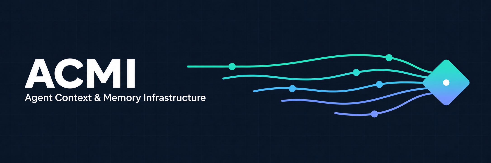
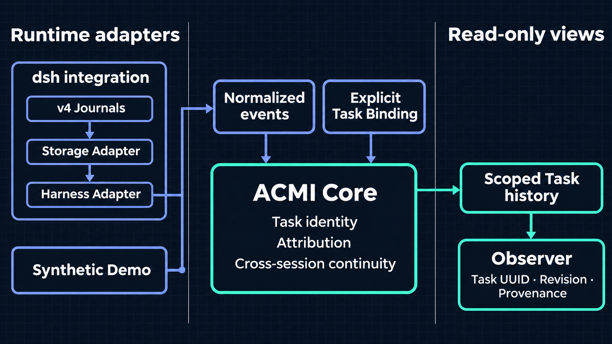

# ACMI



[English](README.md)

ACMI（Agent Context & Memory Infrastructure）为智能体运行时提供跨会话的工作身份。会话切换任务，或另一个会话继续同一任务时，任务 UUID 保持不变。ACMI 记录显式绑定并提供带来源信息的只读历史。它不负责运行智能体，也不是自动任务识别器或长期记忆引擎。

**Alpha 阶段：**无需启动 dsh、提供凭据或调用模型即可运行确定性合成演示。`main` 同时保留截至 Phase 0.9.16 的研究历史，不启用自动任务路由。首个官方集成为 [DeepSeek Harness（dsh）](integrations/dsh/README.md)，目标版本为 `0.2.2-rc.1`；安装和兼容性见 [dsh 快速入门](examples/dsh-quickstart/README.md)。接入其他运行时可从[适配器编写指南](docs/adapter-authoring.md)和[自定义适配器示例](examples/custom-agent-adapter/README.md)开始。

## 快速开始

需要持久化的显式任务续接，可查看实验性的[任务控制台](examples/task-console/README.md)。
它使用专用存储根和操作者确认，不调用 Provider，也不是聊天客户端或模型上下文恢复。
验收边界见[当前进度](docs/runbooks/phase-0.9.17-progress-checkpoint.md)，
主线与开发目录的分工见[工作区组织](docs/workspace-organization.md)。

```sh
pnpm install --frozen-lockfile
pnpm build
pnpm demo
```

演示包含任务切换与恢复、具有因果关联的工具调用和结果、一个未归属事件，以及只读跨会话历史。[入门指南](docs/getting-started.md)说明如何打开 Observer 时间线。

## 架构



图中展示的是数据流，不是包依赖。Core 不依赖 dsh；遇到证据不足的事件时，它会保留未归属状态，而不是猜测所属任务。组件边界详见[架构指南](docs/architecture.md)。

## 实验记录

[完整实验时间线](docs/experiments/README.md)按阶段记录问题、实测、失败、预注册与可复放的合成证据。研究从显式任务续接和确定性恢复，发展到离线身份建议，再验证同一次本地模型生成能否同时输出用户回答与私有归属提案。

- [0.9.10](docs/experiments/phase-0.9.10-final-report.md)：24 次都同时输出两部分，但整包校验后只有 **0/24** 条原生回答。Pilot 停止，未运行正式配对或事后归属对照。
- [0.9.11](docs/experiments/phase-0.9.11-assignment-pilot-report.md)：拆开正文与归属校验后，隔离实验的原生回答和工具因果链恢复，语义门槛仍未通过。
- [0.9.14](docs/experiments/phase-0.9.14-work-anchor-report.md)：可信 WorkAnchor 将显式续接从 **0/4 提升到 4/4**，但没有解决通用任务身份判定。[0.9.15](docs/experiments/phase-0.9.15-relative-proposals-report.md)改善了新目标提案，仍未达标。
- [0.9.16](docs/experiments/phase-0.9.16-unresolved-link-report.md)：模型从未选用新增的未决主题引用。Assistant 正确率仍为 **7/12**，User 从 **11/12 降至 9/12**。这是被测合同的 NO-GO，不是对所有模型的结论。

同次生成在已测试的缓冲路径上可行，但开放任务归属和生产流式路径仍未获资格。模型只提议，可信 Host 验证；锚点不是工具授权，迟到工具结果继承原始调用，而不是当前任务。不自动 Binding、写任务图、接受子结果或满足 Join。

## Alpha 验证结果

验证基线：[v0.1.0-alpha.1](https://github.com/Violet-2ai077/ACMI/releases/tag/v0.1.0-alpha.1)（`0531dbf`）。

| 检查 | 实测结果 |
| --- | --- |
| [GitHub Actions 运行记录](https://github.com/Violet-2ai077/ACMI/actions/runs/42630365718) | Windows 和 Ubuntu 作业均通过，包含锁定依赖安装、依赖审计和 `pnpm check`。 |
| 独立干净克隆 | Windows x64 和 Ubuntu 24.04（WSL）各自 **通过 28/28 项测试**，覆盖 9 个测试文件；两边均完成工作区构建，并运行合成演示、自定义适配器及 dsh 快速入门。 |
| [dsh 集成测试](integrations/dsh/tests/dsh.test.ts) | 在 dsh `0.2.2-rc.1` 的专用 v4 日志夹具中通过 [Level 4 符合性测试](packages/conformance/README.md)：独立重开适配器后，仍能查询两个会话的任务历史。对应的纯文本和 Zstandard 日志在读取前后逐字节一致。 |
| [Observer HTTP 测试](examples/dsh-quickstart/tests/observer-http.test.mjs) | 本地合成 Observer 正常提供只读时间线，并拒绝写请求。 |

复现方法：使用 [`package.json`](package.json) 指定的 Node 和 pnpm 版本，运行 `pnpm install --frozen-lockfile`，再运行 `pnpm check`。以上是受控夹具和集成测试的结果，不代表已验证真实模型流量，也不构成生产安全保证。

**安全限制：**自动持久绑定已禁用；规则与模型归属实验不授予运行时操作权限。dsh 历史读取要求可信本机与单 Workspace 独占的 Storage Root。不支持 Windows 敌对文件竞争环境、多租户服务或 Claude Code / Codex 适配器。详见[安全政策](SECURITY.md)与[安全限制](docs/security-limitations.md)。

## 工作区

| 模块 | 职责 |
| --- | --- |
| [`@acmi/contracts`](packages/contracts/README.md) | 任务、会话、绑定、来源和适配器契约 |
| [`@acmi/core`](packages/core/README.md) | 独立于运行时的任务身份、显式绑定、归因与只读历史 |
| [`@acmi/sdk`](packages/sdk/README.md) | 适配器校验与能力协商 |
| [`@acmi/conformance`](packages/conformance/README.md) | 基于测试夹具的适配器符合性检查 |
| [dsh 集成](integrations/dsh/README.md) | dsh 插件、Harness Adapter、Storage Adapter |
| [Observer](apps/observer/README.md) | 只读伴随视图，不是原生 dsh-context 标签页 |

另见[路线图](ROADMAP.md)、[Alpha 发布说明](docs/releases/v0.1.0-alpha.1.md)、[贡献指南](CONTRIBUTING.md)与[支持渠道](SUPPORT.md)。

ACMI 原创内容采用 [MIT 许可](LICENSE)。第三方内容、许可例外与复用范围见[第三方声明](THIRD_PARTY_NOTICES.md)与[来源说明](docs/source-provenance.md)。
