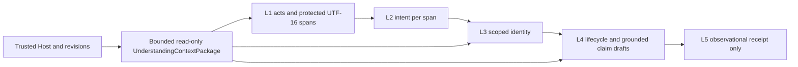

# Layered Understanding Pipeline v0.1

Host 事实、猜测和事务授权分离。Core 的 L1/L2 默认是可测试的确定性低成本控制，不是生产 NLP，也不把词表匹配作为调度门。L3 可独立识别用户讨论的 Task，但讨论、条件、假设、否定、历史引用均不会产生切换操作。L4 生命周期可草拟或要求澄清；独立的逐 Claim 验证在只读图快照上执行，不能从 Task ID 或显式动词直接生成 Graph Event。L5 常量 `no_operation`；本实现不接可信写入口。已有显式 Host CAS 与手动工作流保持原状。

L1 保留 span 与认证 actor、quotation、negation、condition、hypothetical、时间线索；L2 分开 relation/posture/change；L3 输出 active/historical、歧义、不可用、缺失、陈旧、待分配或未知。仅需分析时保留原始当前 user 文本；Assistant/Tool/Subagent 原文不出现在包中。多语语义有意保守，未处理的间接语用明确 unknown。单步对照按整轮一 span 投影，不截断当前 turn；分层解析保留多个 span。跨轮缓存不覆盖已认证 Binding。原有执行/恢复包和生产 Context Injection 均未改动。
